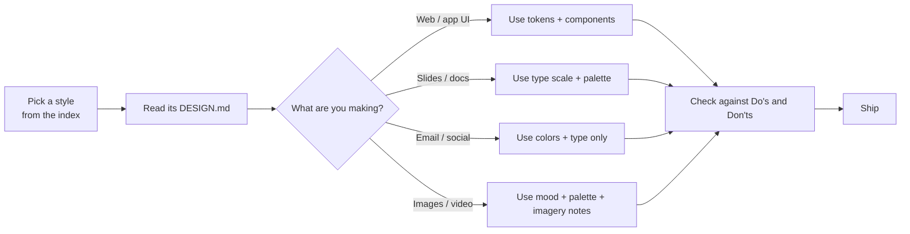

# Refero DESIGN.md Library

<p align="center">
  <b>100 real-world design systems</b>, each as a ready-to-use <code>DESIGN.md</code>,<br/>
  plus a complete guide for AI agents on how to apply any of them to anything.
</p>

<p align="center">
  
  
  
  
</p>

---

## What this is

A `DESIGN.md` is a plain-Markdown spec of a visual system: colors, typography, spacing, shapes, components, do's and don'ts, and an agent prompt guide. An AI agent that reads one can build pages, apps, slides, emails, documents and images that match that look.

This repo holds 100 such files, one per style. Each one was produced from a real site's design system.

## How it works



## Start here

1. **Pick a style.** Browse the index below. Light and dark themes are noted. Mood is a one-line summary.
2. **Give your AI the file and the guide.** Attach [`designs/<style>.md`](designs/) and [`GUIDE-FOR-AI.md`](GUIDE-FOR-AI.md).
3. **Say what you're making.** Any product, page, deck, post, image or document.
4. **Review against the Do's and Don'ts.** Each file lists what to avoid.

Full instructions: **[GUIDE-FOR-AI.md](GUIDE-FOR-AI.md)**.

## Style index

| # | Style | Theme | Mood | Design file |
|---|---|---|---|---|
| 1 | **AI for Business** | light | Brutalist editorial showroom on warm gray | [ai-for-business-DESIGN.md](designs/ai-for-business-DESIGN.md) |
| 2 | **Air** | dark | midnight sky through glass sculpture | [air-DESIGN.md](designs/air-DESIGN.md) |
| 3 | **Airbnb** | light | Quiet white gallery wall with one coral-red bookmark | [airbnb-DESIGN.md](designs/airbnb-DESIGN.md) |
| 4 | **Amrit Palace** | light | spiced parchment gallery — a candlelit beige wall holding sparse saffron punctuation beneath breath-soft serif headlines. | [amrit-palace-DESIGN.md](designs/amrit-palace-DESIGN.md) |
| 5 | **Anthropic** | light | scientific field journal on warm parchment — quiet ivory surfaces, editorial serif headlines, and a single clay accent that only appears when you must act | [anthropic-DESIGN.md](designs/anthropic-DESIGN.md) |
| 6 | **Apollo** | light | Warm brick atelier at golden hour | [apollo-DESIGN.md](designs/apollo-DESIGN.md) |
| 7 | **Apple** | light | white room with a single blue switch. | [apple-DESIGN.md](designs/apple-DESIGN.md) |
| 8 | **Apple** | light | Apple - cinema on white. Vast white editorial space gives way to full-bleed product films, where silhouetted movement and saturated light carry the visual drama. | [apple-airpods-5-DESIGN.md](designs/apple-airpods-5-DESIGN.md) |
| 9 | **Apple (España)** | light | Cathedral of white space with whispered headlines. A vast pale hall where massive weight-700 type hangs in the air, tethered only by pastel product colors and a single blue thread. | [apple-espa-a-2-DESIGN.md](designs/apple-espa-a-2-DESIGN.md) |
| 10 | **Apple (España)** | light | white museum gallery at noon | [apple-espa-a-DESIGN.md](designs/apple-espa-a-DESIGN.md) |
| 11 | **Apple** | dark | Midnight hardware gallery. Treat each section as a dark, museum-like plinth for one precisely lit product detail, with typography and blue controls operating as restrained labels around it. | [apple-iphone-18-pro-DESIGN.md](designs/apple-iphone-18-pro-DESIGN.md) |
| 12 | **Apple** | light | foldable device in a white gallery. Center product renders as the visual event, with typography and blue controls kept deliberately quiet around it. | [apple-iphone-duo-DESIGN.md](designs/apple-iphone-duo-DESIGN.md) |
| 13 | **Apple** | dark | Bronze sensor in darkness. Treat the watch hardware and its health readings as illuminated objects suspended in a near-black gallery. | [apple-watch-series-12-DESIGN.md](designs/apple-watch-series-12-DESIGN.md) |
| 14 | **Apple** | dark | Midnight endurance instrument. Build screens as a sequence of black exhibition bays where oversized SF Pro headlines frame precision hardware, active data, and carefully rationed electric color. | [apple-watch-ultra-4-DESIGN.md](designs/apple-watch-ultra-4-DESIGN.md) |
| 15 | **Auros** | dark | Abyssal terminal with bioluminescent data orbs | [auros-DESIGN.md](designs/auros-DESIGN.md) |
| 16 | **Authkit** | dark | Frosted glass cathedral at midnight | [authkit-DESIGN.md](designs/authkit-DESIGN.md) |
| 17 | **Awesomic** | light | editorial zinc grid with confetti-orange punctuation. | [awesomic-DESIGN.md](designs/awesomic-DESIGN.md) |
| 18 | **BMW.com** | light | Gallery wall for sculpted metal — a typographic frame where the cars are the only color. | [bmw-com-DESIGN.md](designs/bmw-com-DESIGN.md) |
| 19 | **Brex** | light | White concrete, single ember — a clinical financial instrument where one orange spark does all the talking. | [brex-DESIGN.md](designs/brex-DESIGN.md) |
| 20 | **Caldera** | light | forge fire on warm limestone. The canvas is raw warm plaster, and every orange element reads as glowing embers pressed into the surface. | [caldera-DESIGN.md](designs/caldera-DESIGN.md) |
| 21 | **Calendly.com** | light | Navy ink on cool marble. | [calendly-DESIGN.md](designs/calendly-DESIGN.md) |
| 22 | **Champions4good** | dark | midnight sports broadside — a vintage club poster screaming from a plum-dark wall | [champions4good-DESIGN.md](designs/champions4good-DESIGN.md) |
| 23 | **ChatGPT** | light | graphite ink on warm paper | [chatgpt-DESIGN.md](designs/chatgpt-DESIGN.md) |
| 24 | **Claude** | light | Warm parchment printed artifact — ink on bone paper, clay as the only chromatic breath. | [claude-DESIGN.md](designs/claude-DESIGN.md) |
| 25 | **ClickUp™** | light | Hardworking dashboard on white marble. The page is a product brochure for a productivity tool, so the visual language borrows from the product itself: dense lists, status pills, avatar clusters, and bold typographic claims that read like a product spec sheet at exhibition scale. | [clickup-DESIGN.md](designs/clickup-DESIGN.md) |
| 26 | **Column** | light | deep navy ledger under cool dawn | [column-DESIGN.md](designs/column-DESIGN.md) |
| 27 | **Creative Giants** | light | oversized editorial poster on cream paper | [creative-giants-DESIGN.md](designs/creative-giants-DESIGN.md) |
| 28 | **Cursor** | light | Warm parchment atelier lit by embers | [cursor-DESIGN.md](designs/cursor-DESIGN.md) |
| 29 | **Your workplace has the answer. Just ask Dala for it.** | dark | constellation floating on black velvet | [dala-DESIGN.md](designs/dala-DESIGN.md) |
| 30 | **Dimension** | dark | dusk-lit workspace with frosted glass panels | [dimension-DESIGN.md](designs/dimension-DESIGN.md) |
| 31 | **Discord** | dark | Game world behind a chat bubble — every section is a self-contained environment with its own lighting and cast of characters. | [discord-DESIGN.md](designs/discord-DESIGN.md) |
| 32 | **dope.security** | dark | Midnight terminal with violet beacons | [dope-security-DESIGN.md](designs/dope-security-DESIGN.md) |
| 33 | **Dovetail** | dark | blueprint control room at midnight. | [dovetail-DESIGN.md](designs/dovetail-DESIGN.md) |
| 34 | **Dub** | light | frosted link dashboard on rice paper | [dub-DESIGN.md](designs/dub-DESIGN.md) |
| 35 | **Duna** | light | Sunset watercolor on warm marble — a single painted landscape over a quiet, editorial compliance document. | [duna-DESIGN.md](designs/duna-DESIGN.md) |
| 36 | **Duolingo** | light | Playful classroom mascot on white paper | [duolingo-DESIGN.md](designs/duolingo-DESIGN.md) |
| 37 | **ElevenLabs** | light | Warm cream editorial with whispered headlines. A Bauhaus studio notebook — eggshell paper, black ink, a single violet and orange spark for product moments. | [elevenlabs-DESIGN.md](designs/elevenlabs-DESIGN.md) |
| 38 | **Factory** | dark | Terminal war room at midnight. Factory is a stark black control surface where a single white card lands like a flashlit dispatch — the only object in the room is the work itself. | [factory-DESIGN.md](designs/factory-DESIGN.md) |
| 39 | **Figma** | light | white gallery wall with a single indigo spotlight. | [figma-DESIGN.md](designs/figma-DESIGN.md) |
| 40 | **Foodnoms** | light | Sunlit fruit market on white porcelain — warm orange, fresh green, and generous rounded forms | [foodnoms-DESIGN.md](designs/foodnoms-DESIGN.md) |
| 41 | **Function** | light | warm apothecary journal on parchment | [function-DESIGN.md](designs/function-DESIGN.md) |
| 42 | **General Intelligence Company** | light | Literary journal beside a bonfire | [general-intelligence-company-DESIGN.md](designs/general-intelligence-company-DESIGN.md) |
| 43 | **Graphite** | dark | Luminous terminal lattice. Build dark, bordered product surfaces around precise white typography and sparse bursts of spectral light. | [graphite-DESIGN.md](designs/graphite-DESIGN.md) |
| 44 | **Gsap** | dark | animated chalkboard in a design studio. A near-black wall, warm cream chalk, and five color-coded highlighters — one for each animation discipline. | [gsap-DESIGN.md](designs/gsap-DESIGN.md) |
| 45 | **Harness.io** | dark | midnight mission control with phosphor-green accents | [harness-io-DESIGN.md](designs/harness-io-DESIGN.md) |
| 46 | **Hungry Tiger** | dark | Turmeric-bright graffiti on a tandoor wall. A single gold-on-rust palette with display type so large it reads as a spice market sign, not a webpage. | [hungry-tiger-DESIGN.md](designs/hungry-tiger-DESIGN.md) |
| 47 | **Hyer Aviation** | mixed | Cockpit twilight over parchment. A pale dawn-sky meets a slab-serif logo the size of a fuselage, with one warm clay accent breaking the monochrome restraint. | [hyer-aviation-DESIGN.md](designs/hyer-aviation-DESIGN.md) |
| 48 | **Home page \| Impossible Foods** | dark | Blood-red punk poster in velvet darkness. A custom condensed display face bleeds across a wine-dark canvas while single-color red CTAs punch through like a price tag on a butcher's chalkboard. | [impossible-foods-DESIGN.md](designs/impossible-foods-DESIGN.md) |
| 49 | **Integrated Biosciences** | mixed | bioluminescent laboratory at midnight | [integrated-biosciences-DESIGN.md](designs/integrated-biosciences-DESIGN.md) |
| 50 | **Intercom** | light | Warm cream editorial spread | [intercom-DESIGN.md](designs/intercom-DESIGN.md) |
| 51 | **Lamborghini.com** | mixed | Showroom black with one yellow car under spotlights | [lamborghini-com-DESIGN.md](designs/lamborghini-com-DESIGN.md) |
| 52 | **Letters** | light | morning clinic under open sky — a sterile white desk beneath a wash of soft blue, dotted with surgical-blue instruments. | [letters-DESIGN.md](designs/letters-DESIGN.md) |
| 53 | **Linear** | dark | midnight precision instrument | [linear-DESIGN.md](designs/linear-DESIGN.md) |
| 54 | **Mercury** | dark | Alpine banking at blue hour | [mercury-DESIGN.md](designs/mercury-DESIGN.md) |
| 55 | **Micro** | light | sunrise over a digital meadow — a calm horizon gradient holding a quiet, ink-on-paper workspace beneath it. | [micro-DESIGN.md](designs/micro-DESIGN.md) |
| 56 | **Miranda** | light | Old-world broadsheet on warm cream — newspaper editorial for the digital age. | [miranda-DESIGN.md](designs/miranda-DESIGN.md) |
| 57 | **Mobbin** | light | Grayscale specimen board — a printer's proof sheet where typographic weight IS color. | [mobbin-DESIGN.md](designs/mobbin-DESIGN.md) |
| 58 | **Modal** | dark | Phosphor terminal in a darkened server room — the vivid green is the only light source. | [modal-DESIGN.md](designs/modal-DESIGN.md) |
| 59 | **Modern Treasury** | light | Treasury ledger on graph paper. Build pages as a quiet white operating sheet where money flows are mapped with fine lines, labeled nodes, and exact dark controls. | [modern-treasury-DESIGN.md](designs/modern-treasury-DESIGN.md) |
| 60 | **Monad** | light | editorial tech journal on warm parchment | [monad-DESIGN.md](designs/monad-DESIGN.md) |
| 61 | **monday.com** | light | white workshop with pastel sticky notes | [monday-com-DESIGN.md](designs/monday-com-DESIGN.md) |
| 62 | **monopo saigon** | light | Liquid iridescence behind editorial silence — a monochrome editorial gallery floating on molten light. | [monopo-saigon-DESIGN.md](designs/monopo-saigon-DESIGN.md) |
| 63 | **Notion** | light | warm paper notebook under afternoon sun | [notion-DESIGN.md](designs/notion-DESIGN.md) |
| 64 | **OFF+BRAND.** | light | Iridescent sphere on warm parchment | [off-brand-DESIGN.md](designs/off-brand-DESIGN.md) |
| 65 | **OpenAI** | light | Research lab notebook at noon. | [openai-DESIGN.md](designs/openai-DESIGN.md) |
| 66 | **Origin Financial** | dark | midnight gallery of quiet wealth. A hushed, near-black room where oversized serif whispers and a few luminous color panels make finance feel like curated art. | [origin-financial-DESIGN.md](designs/origin-financial-DESIGN.md) |
| 67 | **ORYZO AI** | dark | Darkroom product editorial. A lone object floating in warm darkness, cream typography the only decoration. | [oryzo-ai-DESIGN.md](designs/oryzo-ai-DESIGN.md) |
| 68 | **Paste** | light | Amber lantern on white marble — the brand's warm gradient logo floats in vast white space, like a single lit window in a snow-covered building. | [paste-DESIGN.md](designs/paste-DESIGN.md) |
| 69 | **Perk** | light | electric lime on warm parchment paper | [perk-DESIGN.md](designs/perk-DESIGN.md) |
| 70 | **Perplexity AI** | light | scholar's parchment behind clean glass | [perplexity-ai-DESIGN.md](designs/perplexity-ai-DESIGN.md) |
| 71 | **Portrait** | light | polaroid memory wall on cream paper. A bright, off-white scrapbook where deep-navy ink provides the only text, the only structural lines, and the only border color — with a single hand-drawn rainbow that appears once, on the Sign up button and on the italicized word forever, and never again. | [portrait-DESIGN.md](designs/portrait-DESIGN.md) |
| 72 | **Quizlet** | light | color-coded classroom on white — a quiet study desk where four pastel flashcards are the only splash of color against cool gray walls and a single indigo highlighter mark. | [quizlet-DESIGN.md](designs/quizlet-DESIGN.md) |
| 73 | **Ramp** | light | Editorial finance desk, black-and-white pages with a single neon highlighter. A near-monochrome publication surface where one vivid chartreuse mark turns every interaction into a money signal. | [ramp-DESIGN.md](designs/ramp-DESIGN.md) |
| 74 | **Raycast** | dark | Midnight command center, coral neon | [raycast-DESIGN.md](designs/raycast-DESIGN.md) |
| 75 | **Reflect Notes** | dark | starlit violet cosmos — a dark observatory where notes float like constellations against a near-black indigo void. | [reflect-notes-DESIGN.md](designs/reflect-notes-DESIGN.md) |
| 76 | **Resend** | dark | black velvet with violet neon | [resend-DESIGN.md](designs/resend-DESIGN.md) |
| 77 | **Revolut** | light | Monochrome editorial banking on cloud photography — white ink, pill buttons, one blue ribbon of color in an otherwise grayscale world. | [revolut-DESIGN.md](designs/revolut-DESIGN.md) |
| 78 | **Samara** | light | Sunlit architectural model. The design combines the precision of a blueprint with the warmth and airiness of natural light. | [samara-DESIGN.md](designs/samara-DESIGN.md) |
| 79 | **Seed** | light | living organism under laboratory glass | [seed-DESIGN.md](designs/seed-DESIGN.md) |
| 80 | **Seline Analytics** | light | Quiet analyst's desk on warm paper | [seline-analytics-DESIGN.md](designs/seline-analytics-DESIGN.md) |
| 81 | **Shop** | light | Floating shopping constellation on white marble | [shop-DESIGN.md](designs/shop-DESIGN.md) |
| 82 | **Slush** | light | inflatable sticker universe on pastel paper | [slush-DESIGN.md](designs/slush-DESIGN.md) |
| 83 | **Steep** | light | serif analytics on warm paper | [steep-DESIGN.md](designs/steep-DESIGN.md) |
| 84 | **Stripe** | light | indigo-ink ledger on frosted glass | [stripe-DESIGN.md](designs/stripe-DESIGN.md) |
| 85 | **Structured** | mixed | Renaissance gallery on putty paper | [structured-DESIGN.md](designs/structured-DESIGN.md) |
| 86 | **Studio.Design** | light | Gallery wall in motion. Build each screen as a quiet gray exhibition surface where editorial typography and overlapping creative work compete for attention. | [studio-design-DESIGN.md](designs/studio-design-DESIGN.md) |
| 87 | **Supabase** | dark | Midnight code editor with phosphor green caret — a single chromatic pulse on a sea of charcoal. | [supabase-DESIGN.md](designs/supabase-DESIGN.md) |
| 88 | **Superhuman** | light | golden hour editorial dashboard | [superhuman-DESIGN.md](designs/superhuman-DESIGN.md) |
| 89 | **Superr** | light | Warm schoolyard notebook in soft afternoon light. A cream page, an orange marker uncapped, and a stack of sticker-laminated name labels waiting to be peeled. | [superr-DESIGN.md](designs/superr-DESIGN.md) |
| 90 | **sweetgreen** | light | farm-stand chalkboard at golden hour | [sweetgreen-DESIGN.md](designs/sweetgreen-DESIGN.md) |
| 91 | **teenage engineering** | light | industrial catalogue under studio light — the product is the only rich object on the page and everything else is whispered around it | [teenage-engineering-DESIGN.md](designs/teenage-engineering-DESIGN.md) |
| 92 | **Things** | light | Apple keynote at half volume — a gallery wall of tilted product frames floating on a quiet cool-gray canvas, with one vivid blue spark pulling the eye to every interactive moment. | [things-DESIGN.md](designs/things-DESIGN.md) |
| 93 | **Ui** | light | clinical blueprint on frosted paper | [ui-DESIGN.md](designs/ui-DESIGN.md) |
| 94 | **Ventriloc** | light | Editorial data observatory on warm paper — a single orange ember punctuating monochrome precision. | [ventriloc-DESIGN.md](designs/ventriloc-DESIGN.md) |
| 95 | **Vercel** | light | Typeset terminal on white paper | [vercel-DESIGN.md](designs/vercel-DESIGN.md) |
| 96 | **VISIONNAIRE** | light | Editorial streetwear gallery on bone-white. The brand behaves like a printed lookbook: flat white canvas, sharp black ink, and a single warm cream panel used as a colour-block stage for product or wordmark. | [visionnaire-DESIGN.md](designs/visionnaire-DESIGN.md) |
| 97 | **Visitors** | light | white engineering blueprint | [visitors-DESIGN.md](designs/visitors-DESIGN.md) |
| 98 | **Vivid+Co** | dark | prismatic light through obsidian | [vivid-co-DESIGN.md](designs/vivid-co-DESIGN.md) |
| 99 | **Webflow** | light | white studio, black ink, one blue mark — a designer's drafting table rendered as a web page. | [webflow-DESIGN.md](designs/webflow-DESIGN.md) |
| 100 | **Wise** | light | deep moss with lime voltage. Lime sparks on a near-black forest floor, with massive blocky display type announcing every move. | [wise-DESIGN.md](designs/wise-DESIGN.md) |

## Using a style, at a glance

| You want to make | Use from the DESIGN.md | Tip |
|---|---|---|
| A web page or app screen | Tokens, components, layout, do's and don'ts | Build components from the spec first, not from the screenshot |
| A slide deck | Colors, type scale, surfaces | Keep one accent color per slide |
| An email | Colors, type, button style | Test on a narrow screen |
| A social post or banner | Palette, type, imagery notes | Two fonts maximum |
| A logo or illustration | Palette and mood only | Never copy a real logo or trademark |
| A document or report | Type scale, spacing, tables | Match heading weights, not just sizes |

## Good to know

- These files are **references for style**, not licenses to use a brand's assets. Do not reproduce logos, trademarks, photos or copyrighted text from the source sites.
- Some styles belong to well-known companies. Use them for inspiration or for a look-alike. Do not present your work as coming from that company.
- The measurements are normalized and the recommendations are interpretive. Check the output by eye.

## Repository layout

```
refero-design-library/
├── README.md            ← you are here
├── GUIDE-FOR-AI.md      ← full guide for agents: how to apply any style to anything
├── designs/             ← one DESIGN.md per style (100 files)
└── .gitignore
```

## Credits and rights

The style data comes from public design systems gathered from [styles.refero.design](https://styles.refero.design). Each style belongs to its original site. This repo is a reference collection.
