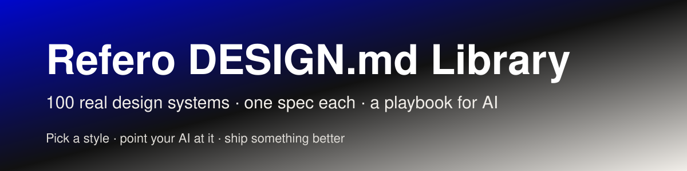
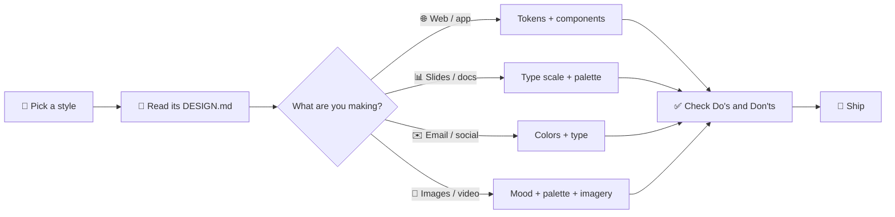

<p align="center">
  Source of every style: <a href="https://styles.refero.design"><b>styles.refero.design</b></a> (Refero Styles)
</p>

<p align="center">
  
</p>

<p align="center">
  
  
  
  
  
</p>

---

## ⚡ Quick start

| | Step | Do this |
|:-:|---|---|
| **1️⃣** | **Pick a style** | Browse the [index](#-style-index) or search [`styles.json`](styles.json) by mood and theme. |
| **2️⃣** | **Hand it to your AI** | Give it the repo, or the one `DESIGN.md` you chose, plus [`AGENTS.md`](AGENTS.md). |
| **3️⃣** | **Ask for an outcome** | Describe the goal. The AI audits, recommends, then applies. |

> 💬 **Example prompts**
>
> - *"Audit my landing page at `./site` and give me ranked recommendations using this library."*
> - *"Make my deck 10x better. Use whichever style fits the audience."*
> - *"Restyle this app to feel like a premium developer tool."*

Your AI starts with **[AGENTS.md](AGENTS.md)**, shortlists from **[styles.json](styles.json)**, applies a chosen **DESIGN.md**, and follows **[GUIDE-FOR-AI.md](GUIDE-FOR-AI.md)**.

---

## 🧭 How it works



---

## 🧩 What's in a DESIGN.md

| Section | You get |
|---|---|
| 🎨 **Colors** | Exact hex values, token names, and the role of each color |
| 🔤 **Typography** | Families, weights, sizes, line heights, letter spacing |
| 📐 **Spacing & shapes** | Spacing scale, radius, borders, shadows |
| 🧱 **Components** | Buttons, cards, inputs, nav, anatomy and states |
| ✅ **Do's and Don'ts** | Hard rules to obey |
| 🤖 **Agent Prompt Guide** | The file's own instructions for an AI |

---

## 🎯 Use cases at a glance

| You want to make | Use from the DESIGN.md | Tip |
|---|---|---|
| 🌐 Web page or app | Tokens, components, layout | Build components from the spec, not the screenshot |
| 📊 Slide deck | Colors, type scale, surfaces | One accent color per slide |
| ✉️ Email | Colors, type, button style | Test on a narrow screen |
| 📱 Social post or banner | Palette, type, imagery | Two fonts at most |
| 🖼️ Image or illustration | Palette and mood | Never copy a real logo |
| 📄 Document or report | Type scale, tables, spacing | Match heading weights, not just sizes |

---

## 🎨 Style index

**100 styles** · 68 light · 32 dark. Each row shows four palette swatches.

<details open>
<summary><b>☀️ Light styles (68)</b></summary>

| Style | Mood | Palette | File |
|---|---|---|---|
| **AI for Business** | Brutalist editorial showroom on warm gray |     | [`ai-for-business-DESIGN.md`](designs/ai-for-business-DESIGN.md) |
| **Airbnb** | Quiet white gallery wall with one coral-red bookmark |     | [`airbnb-DESIGN.md`](designs/airbnb-DESIGN.md) |
| **Amrit Palace** | spiced parchment gallery — a candlelit beige wall holding sparse saffron punctuation beneath breath-soft serif headlines. |     | [`amrit-palace-DESIGN.md`](designs/amrit-palace-DESIGN.md) |
| **Anthropic** | scientific field journal on warm parchment — quiet ivory surfaces, editorial serif headlines, and a single clay accent that only appears when you must act |     | [`anthropic-DESIGN.md`](designs/anthropic-DESIGN.md) |
| **Apollo** | Warm brick atelier at golden hour |     | [`apollo-DESIGN.md`](designs/apollo-DESIGN.md) |
| **Apple** | white room with a single blue switch. |     | [`apple-DESIGN.md`](designs/apple-DESIGN.md) |
| **Apple** | Apple - cinema on white. Vast white editorial space gives way to full-bleed product films, where silhouetted movement and saturated light carry the visual drama. |     | [`apple-airpods-5-DESIGN.md`](designs/apple-airpods-5-DESIGN.md) |
| **Apple** | foldable device in a white gallery. Center product renders as the visual event, with typography and blue controls kept deliberately quiet around it. |     | [`apple-iphone-duo-DESIGN.md`](designs/apple-iphone-duo-DESIGN.md) |
| **Apple (España)** | Cathedral of white space with whispered headlines. A vast pale hall where massive weight-700 type hangs in the air, tethered only by pastel product colors and a single blue thread. |     | [`apple-espa-a-2-DESIGN.md`](designs/apple-espa-a-2-DESIGN.md) |
| **Apple (España)** | white museum gallery at noon |     | [`apple-espa-a-DESIGN.md`](designs/apple-espa-a-DESIGN.md) |
| **Awesomic** | editorial zinc grid with confetti-orange punctuation. |     | [`awesomic-DESIGN.md`](designs/awesomic-DESIGN.md) |
| **BMW.com** | Gallery wall for sculpted metal — a typographic frame where the cars are the only color. |     | [`bmw-com-DESIGN.md`](designs/bmw-com-DESIGN.md) |
| **Brex** | White concrete, single ember — a clinical financial instrument where one orange spark does all the talking. |     | [`brex-DESIGN.md`](designs/brex-DESIGN.md) |
| **Caldera** | forge fire on warm limestone. The canvas is raw warm plaster, and every orange element reads as glowing embers pressed into the surface. |     | [`caldera-DESIGN.md`](designs/caldera-DESIGN.md) |
| **Calendly.com** | Navy ink on cool marble. |     | [`calendly-DESIGN.md`](designs/calendly-DESIGN.md) |
| **ChatGPT** | graphite ink on warm paper |     | [`chatgpt-DESIGN.md`](designs/chatgpt-DESIGN.md) |
| **Claude** | Warm parchment printed artifact — ink on bone paper, clay as the only chromatic breath. |     | [`claude-DESIGN.md`](designs/claude-DESIGN.md) |
| **ClickUp™** | Hardworking dashboard on white marble. The page is a product brochure for a productivity tool, so the visual language borrows from the product itself: dense lists, status pills, avatar clusters, and bold typographic claims that read like a product spec sheet at exhibition scale. |     | [`clickup-DESIGN.md`](designs/clickup-DESIGN.md) |
| **Column** | deep navy ledger under cool dawn |     | [`column-DESIGN.md`](designs/column-DESIGN.md) |
| **Creative Giants** | oversized editorial poster on cream paper |     | [`creative-giants-DESIGN.md`](designs/creative-giants-DESIGN.md) |
| **Cursor** | Warm parchment atelier lit by embers |     | [`cursor-DESIGN.md`](designs/cursor-DESIGN.md) |
| **Dub** | frosted link dashboard on rice paper |     | [`dub-DESIGN.md`](designs/dub-DESIGN.md) |
| **Duna** | Sunset watercolor on warm marble — a single painted landscape over a quiet, editorial compliance document. |     | [`duna-DESIGN.md`](designs/duna-DESIGN.md) |
| **Duolingo** | Playful classroom mascot on white paper |     | [`duolingo-DESIGN.md`](designs/duolingo-DESIGN.md) |
| **ElevenLabs** | Warm cream editorial with whispered headlines. A Bauhaus studio notebook — eggshell paper, black ink, a single violet and orange spark for product moments. |     | [`elevenlabs-DESIGN.md`](designs/elevenlabs-DESIGN.md) |
| **Figma** | white gallery wall with a single indigo spotlight. |     | [`figma-DESIGN.md`](designs/figma-DESIGN.md) |
| **Foodnoms** | Sunlit fruit market on white porcelain — warm orange, fresh green, and generous rounded forms |     | [`foodnoms-DESIGN.md`](designs/foodnoms-DESIGN.md) |
| **Function** | warm apothecary journal on parchment |     | [`function-DESIGN.md`](designs/function-DESIGN.md) |
| **General Intelligence Company** | Literary journal beside a bonfire |     | [`general-intelligence-company-DESIGN.md`](designs/general-intelligence-company-DESIGN.md) |
| **Intercom** | Warm cream editorial spread |     | [`intercom-DESIGN.md`](designs/intercom-DESIGN.md) |
| **Letters** | morning clinic under open sky — a sterile white desk beneath a wash of soft blue, dotted with surgical-blue instruments. |     | [`letters-DESIGN.md`](designs/letters-DESIGN.md) |
| **Micro** | sunrise over a digital meadow — a calm horizon gradient holding a quiet, ink-on-paper workspace beneath it. |     | [`micro-DESIGN.md`](designs/micro-DESIGN.md) |
| **Miranda** | Old-world broadsheet on warm cream — newspaper editorial for the digital age. |     | [`miranda-DESIGN.md`](designs/miranda-DESIGN.md) |
| **Mobbin** | Grayscale specimen board — a printer's proof sheet where typographic weight IS color. |     | [`mobbin-DESIGN.md`](designs/mobbin-DESIGN.md) |
| **Modern Treasury** | Treasury ledger on graph paper. Build pages as a quiet white operating sheet where money flows are mapped with fine lines, labeled nodes, and exact dark controls. |     | [`modern-treasury-DESIGN.md`](designs/modern-treasury-DESIGN.md) |
| **Monad** | editorial tech journal on warm parchment |     | [`monad-DESIGN.md`](designs/monad-DESIGN.md) |
| **monday.com** | white workshop with pastel sticky notes |     | [`monday-com-DESIGN.md`](designs/monday-com-DESIGN.md) |
| **monopo saigon** | Liquid iridescence behind editorial silence — a monochrome editorial gallery floating on molten light. |     | [`monopo-saigon-DESIGN.md`](designs/monopo-saigon-DESIGN.md) |
| **Notion** | warm paper notebook under afternoon sun |     | [`notion-DESIGN.md`](designs/notion-DESIGN.md) |
| **OFF+BRAND.** | Iridescent sphere on warm parchment |     | [`off-brand-DESIGN.md`](designs/off-brand-DESIGN.md) |
| **OpenAI** | Research lab notebook at noon. |     | [`openai-DESIGN.md`](designs/openai-DESIGN.md) |
| **Paste** | Amber lantern on white marble — the brand's warm gradient logo floats in vast white space, like a single lit window in a snow-covered building. |     | [`paste-DESIGN.md`](designs/paste-DESIGN.md) |
| **Perk** | electric lime on warm parchment paper |     | [`perk-DESIGN.md`](designs/perk-DESIGN.md) |
| **Perplexity AI** | scholar's parchment behind clean glass |     | [`perplexity-ai-DESIGN.md`](designs/perplexity-ai-DESIGN.md) |
| **Portrait** | polaroid memory wall on cream paper. A bright, off-white scrapbook where deep-navy ink provides the only text, the only structural lines, and the only border color — with a single hand-drawn rainbow that appears once, on the Sign up button and on the italicized word forever, and never again. |     | [`portrait-DESIGN.md`](designs/portrait-DESIGN.md) |
| **Quizlet** | color-coded classroom on white — a quiet study desk where four pastel flashcards are the only splash of color against cool gray walls and a single indigo highlighter mark. |     | [`quizlet-DESIGN.md`](designs/quizlet-DESIGN.md) |
| **Ramp** | Editorial finance desk, black-and-white pages with a single neon highlighter. A near-monochrome publication surface where one vivid chartreuse mark turns every interaction into a money signal. |     | [`ramp-DESIGN.md`](designs/ramp-DESIGN.md) |
| **Revolut** | Monochrome editorial banking on cloud photography — white ink, pill buttons, one blue ribbon of color in an otherwise grayscale world. |     | [`revolut-DESIGN.md`](designs/revolut-DESIGN.md) |
| **Samara** | Sunlit architectural model. The design combines the precision of a blueprint with the warmth and airiness of natural light. |     | [`samara-DESIGN.md`](designs/samara-DESIGN.md) |
| **Seed** | living organism under laboratory glass |     | [`seed-DESIGN.md`](designs/seed-DESIGN.md) |
| **Seline Analytics** | Quiet analyst's desk on warm paper |     | [`seline-analytics-DESIGN.md`](designs/seline-analytics-DESIGN.md) |
| **Shop** | Floating shopping constellation on white marble |     | [`shop-DESIGN.md`](designs/shop-DESIGN.md) |
| **Slush** | inflatable sticker universe on pastel paper |     | [`slush-DESIGN.md`](designs/slush-DESIGN.md) |
| **Steep** | serif analytics on warm paper |     | [`steep-DESIGN.md`](designs/steep-DESIGN.md) |
| **Stripe** | indigo-ink ledger on frosted glass |     | [`stripe-DESIGN.md`](designs/stripe-DESIGN.md) |
| **Studio.Design** | Gallery wall in motion. Build each screen as a quiet gray exhibition surface where editorial typography and overlapping creative work compete for attention. |     | [`studio-design-DESIGN.md`](designs/studio-design-DESIGN.md) |
| **Superhuman** | golden hour editorial dashboard |     | [`superhuman-DESIGN.md`](designs/superhuman-DESIGN.md) |
| **Superr** | Warm schoolyard notebook in soft afternoon light. A cream page, an orange marker uncapped, and a stack of sticker-laminated name labels waiting to be peeled. |     | [`superr-DESIGN.md`](designs/superr-DESIGN.md) |
| **sweetgreen** | farm-stand chalkboard at golden hour |     | [`sweetgreen-DESIGN.md`](designs/sweetgreen-DESIGN.md) |
| **teenage engineering** | industrial catalogue under studio light — the product is the only rich object on the page and everything else is whispered around it |     | [`teenage-engineering-DESIGN.md`](designs/teenage-engineering-DESIGN.md) |
| **Things** | Apple keynote at half volume — a gallery wall of tilted product frames floating on a quiet cool-gray canvas, with one vivid blue spark pulling the eye to every interactive moment. |     | [`things-DESIGN.md`](designs/things-DESIGN.md) |
| **Ui** | clinical blueprint on frosted paper |     | [`ui-DESIGN.md`](designs/ui-DESIGN.md) |
| **Ventriloc** | Editorial data observatory on warm paper — a single orange ember punctuating monochrome precision. |     | [`ventriloc-DESIGN.md`](designs/ventriloc-DESIGN.md) |
| **Vercel** | Typeset terminal on white paper |     | [`vercel-DESIGN.md`](designs/vercel-DESIGN.md) |
| **VISIONNAIRE** | Editorial streetwear gallery on bone-white. The brand behaves like a printed lookbook: flat white canvas, sharp black ink, and a single warm cream panel used as a colour-block stage for product or wordmark. |     | [`visionnaire-DESIGN.md`](designs/visionnaire-DESIGN.md) |
| **Visitors** | white engineering blueprint |     | [`visitors-DESIGN.md`](designs/visitors-DESIGN.md) |
| **Webflow** | white studio, black ink, one blue mark — a designer's drafting table rendered as a web page. |     | [`webflow-DESIGN.md`](designs/webflow-DESIGN.md) |
| **Wise** | deep moss with lime voltage. Lime sparks on a near-black forest floor, with massive blocky display type announcing every move. |     | [`wise-DESIGN.md`](designs/wise-DESIGN.md) |

</details>

<details>
<summary><b>🌙 Dark styles (32)</b></summary>

| Style | Mood | Palette | File |
|---|---|---|---|
| **Air** | midnight sky through glass sculpture |     | [`air-DESIGN.md`](designs/air-DESIGN.md) |
| **Apple** | Midnight hardware gallery. Treat each section as a dark, museum-like plinth for one precisely lit product detail, with typography and blue controls operating as restrained labels around it. |     | [`apple-iphone-18-pro-DESIGN.md`](designs/apple-iphone-18-pro-DESIGN.md) |
| **Apple** | Bronze sensor in darkness. Treat the watch hardware and its health readings as illuminated objects suspended in a near-black gallery. |     | [`apple-watch-series-12-DESIGN.md`](designs/apple-watch-series-12-DESIGN.md) |
| **Apple** | Midnight endurance instrument. Build screens as a sequence of black exhibition bays where oversized SF Pro headlines frame precision hardware, active data, and carefully rationed electric color. |     | [`apple-watch-ultra-4-DESIGN.md`](designs/apple-watch-ultra-4-DESIGN.md) |
| **Auros** | Abyssal terminal with bioluminescent data orbs |     | [`auros-DESIGN.md`](designs/auros-DESIGN.md) |
| **Authkit** | Frosted glass cathedral at midnight |     | [`authkit-DESIGN.md`](designs/authkit-DESIGN.md) |
| **Champions4good** | midnight sports broadside — a vintage club poster screaming from a plum-dark wall |     | [`champions4good-DESIGN.md`](designs/champions4good-DESIGN.md) |
| **Dimension** | dusk-lit workspace with frosted glass panels |     | [`dimension-DESIGN.md`](designs/dimension-DESIGN.md) |
| **Discord** | Game world behind a chat bubble — every section is a self-contained environment with its own lighting and cast of characters. |     | [`discord-DESIGN.md`](designs/discord-DESIGN.md) |
| **dope.security** | Midnight terminal with violet beacons |     | [`dope-security-DESIGN.md`](designs/dope-security-DESIGN.md) |
| **Dovetail** | blueprint control room at midnight. |     | [`dovetail-DESIGN.md`](designs/dovetail-DESIGN.md) |
| **Factory** | Terminal war room at midnight. Factory is a stark black control surface where a single white card lands like a flashlit dispatch — the only object in the room is the work itself. |     | [`factory-DESIGN.md`](designs/factory-DESIGN.md) |
| **Graphite** | Luminous terminal lattice. Build dark, bordered product surfaces around precise white typography and sparse bursts of spectral light. |     | [`graphite-DESIGN.md`](designs/graphite-DESIGN.md) |
| **Gsap** | animated chalkboard in a design studio. A near-black wall, warm cream chalk, and five color-coded highlighters — one for each animation discipline. |     | [`gsap-DESIGN.md`](designs/gsap-DESIGN.md) |
| **Harness.io** | midnight mission control with phosphor-green accents |     | [`harness-io-DESIGN.md`](designs/harness-io-DESIGN.md) |
| **Home page | Impossible Foods** | Blood-red punk poster in velvet darkness. A custom condensed display face bleeds across a wine-dark canvas while single-color red CTAs punch through like a price tag on a butcher's chalkboard. |     | [`impossible-foods-DESIGN.md`](designs/impossible-foods-DESIGN.md) |
| **Hungry Tiger** | Turmeric-bright graffiti on a tandoor wall. A single gold-on-rust palette with display type so large it reads as a spice market sign, not a webpage. |     | [`hungry-tiger-DESIGN.md`](designs/hungry-tiger-DESIGN.md) |
| **Hyer Aviation** | Cockpit twilight over parchment. A pale dawn-sky meets a slab-serif logo the size of a fuselage, with one warm clay accent breaking the monochrome restraint. |     | [`hyer-aviation-DESIGN.md`](designs/hyer-aviation-DESIGN.md) |
| **Integrated Biosciences** | bioluminescent laboratory at midnight |     | [`integrated-biosciences-DESIGN.md`](designs/integrated-biosciences-DESIGN.md) |
| **Lamborghini.com** | Showroom black with one yellow car under spotlights |     | [`lamborghini-com-DESIGN.md`](designs/lamborghini-com-DESIGN.md) |
| **Linear** | midnight precision instrument |     | [`linear-DESIGN.md`](designs/linear-DESIGN.md) |
| **Mercury** | Alpine banking at blue hour |     | [`mercury-DESIGN.md`](designs/mercury-DESIGN.md) |
| **Modal** | Phosphor terminal in a darkened server room — the vivid green is the only light source. |     | [`modal-DESIGN.md`](designs/modal-DESIGN.md) |
| **Origin Financial** | midnight gallery of quiet wealth. A hushed, near-black room where oversized serif whispers and a few luminous color panels make finance feel like curated art. |     | [`origin-financial-DESIGN.md`](designs/origin-financial-DESIGN.md) |
| **ORYZO AI** | Darkroom product editorial. A lone object floating in warm darkness, cream typography the only decoration. |     | [`oryzo-ai-DESIGN.md`](designs/oryzo-ai-DESIGN.md) |
| **Raycast** | Midnight command center, coral neon |     | [`raycast-DESIGN.md`](designs/raycast-DESIGN.md) |
| **Reflect Notes** | starlit violet cosmos — a dark observatory where notes float like constellations against a near-black indigo void. |     | [`reflect-notes-DESIGN.md`](designs/reflect-notes-DESIGN.md) |
| **Resend** | black velvet with violet neon |     | [`resend-DESIGN.md`](designs/resend-DESIGN.md) |
| **Structured** | Renaissance gallery on putty paper |     | [`structured-DESIGN.md`](designs/structured-DESIGN.md) |
| **Supabase** | Midnight code editor with phosphor green caret — a single chromatic pulse on a sea of charcoal. |     | [`supabase-DESIGN.md`](designs/supabase-DESIGN.md) |
| **Vivid+Co** | prismatic light through obsidian |     | [`vivid-co-DESIGN.md`](designs/vivid-co-DESIGN.md) |
| **Your workplace has the answer. Just ask Dala for it.** | constellation floating on black velvet |     | [`dala-DESIGN.md`](designs/dala-DESIGN.md) |

</details>

---

## ⚠️ Good to know

- 📌 These are **style references**, not licenses to use a brand's assets.
- 🚫 Don't reproduce logos, trademarks, photos, or copyrighted text from the source sites.
- 🏷️ Some styles belong to well-known companies. Use them for inspiration, not to imply the work came from them.
- 🔍 Measurements are normalized and recommendations are interpretive. Check the output by eye.

---

## 🗂️ Repository layout

```
refero-design-library/
├── 📘 README.md          ← you are here
├── 🤖 AGENTS.md          ← entry point for any AI
├── 🔗 CLAUDE.md          ← points Claude Code at AGENTS.md
├── 🗃️ styles.json        ← machine-readable index
├── 📖 GUIDE-FOR-AI.md    ← full application guide
├── 🎨 designs/           ← 100 DESIGN.md files
└── 🖼️ assets/            ← banner
```

---

## 🙏 Credits

Style data comes from public design systems gathered at [styles.refero.design](https://styles.refero.design). Each style belongs to its original site. This repo is a reference collection.
